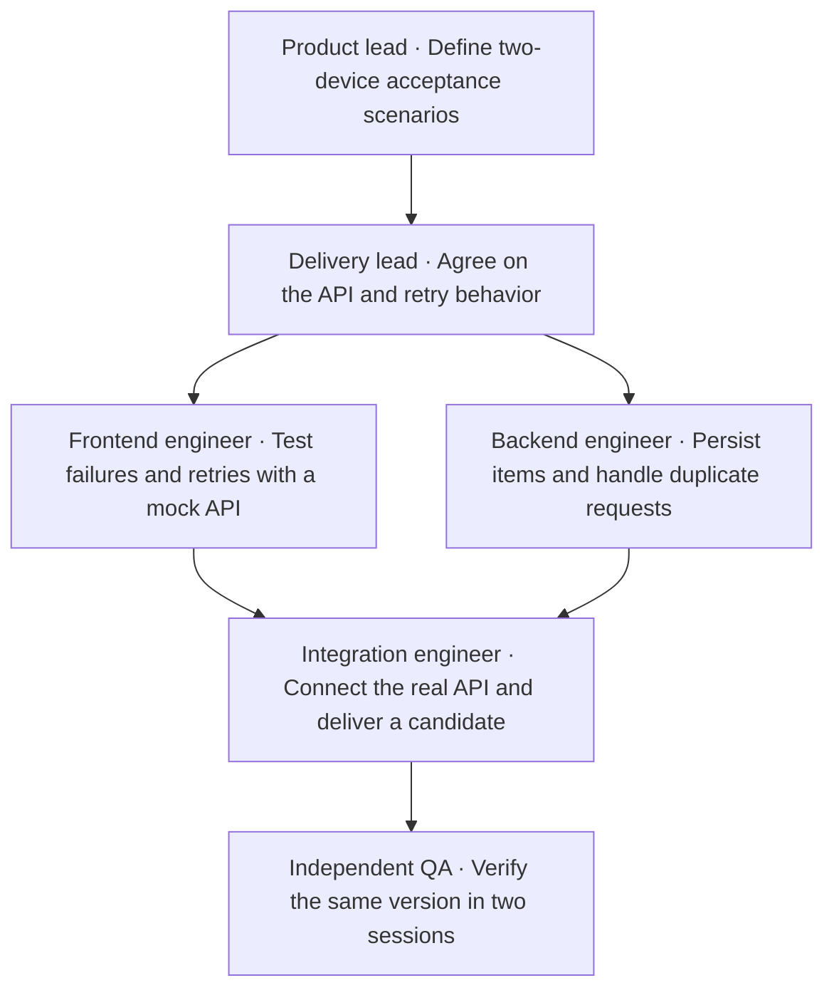

# Pioneers

[中文](README.md) · [English documentation index](docs/english.md)

Pioneers lets you run a development team inside the AI coding assistant you already use. You set the goal. The team agrees on acceptance criteria, engineers work on tasks as their dependencies become available, and independent QA checks the delivered version against each criterion. The project dashboard shows which decisions need you, who is waiting for whom, and what evidence supports delivery.

Small changes follow **development → independent QA** by default. Suppose a to-do list accepts titles containing only spaces. One engineer fixes it and runs a self-test. A separate QA member verifies on the same version that blank titles are rejected and valid ones can still be added. The iteration can then close. [Two-step fix example](examples/small-fix.json)

[Use Pioneers in your project](#use-pioneers-in-your-coding-assistant) · [Try the CLI offline](#local-cli-quick-start) · [Full user manual](docs/usage.en.md)

## How a request moves through the team

Suppose a user wants a to-do item created on a computer to appear on their phone. **If the phone never receives a success response and the user taps Retry, how many items should appear?** The answer shapes the interface, API and tests. [Complete multi-device workflow](examples/todo-sync.json)



**What do product and design hand off?** The product lead (PM) turns “appears on my phone” into reproducible scenarios. Device B can read what device A created. A failed creation can be retried, and a single creation ultimately yields one item. The delivery lead (LD) specifies the authoritative data source, how the API reports failure, and how a retry identifies the original request. The frontend engineer can start against a mock while the backend engineer implements persistence. The example records those dependencies. The local CLI executes the tasks in dependency order. For concurrent frontend and backend work, use a clean Git project with an existing commit, declare disjoint `write_paths`, and use a host that can run each task in its own workspace.

**Who decides the version is ready?** The integration engineer delivers a candidate, records of testing with the real API, and steps for reproducing the result. QA reruns the original scenarios. If a retry creates two items, QA can return the failure and its evidence to the responsible implementation task. After the fix, Pioneers requeues affected integration and verification tasks and preserves the earlier results for comparison.

Pioneers itself uses this process. When adding images and narration to the dashboard, one engineer integrated the provider that generated the files, another made them reusable after a disconnect, and another presented the files and their usage on the dashboard. After integration, the team opened two paper-boat images and played a Chinese narration clip from the dashboard to verify that a user could actually retrieve the outputs. [Code and tests from that iteration](https://github.com/gunbi/pioneers/compare/c015001...fd46930)

## How you lead the team

**Choose when to get involved.** Routine fixes can go straight to implementation and verification. Changes to permissions, shared interfaces or data that is hard to roll back go through design and your approval on the dashboard. The independently started project dashboard can still accept approvals after the coordinator session exits. Reconnect to the original iteration and the team can claim the released tasks. [Human approval and intervention](docs/usage.en.md#human-approval-and-intervention) · [Executor recovery](docs/usage.en.md#executor-recovery)

**Authorize skills by role and load them by task.** In the two-device example, the LD uses the architecture design skill to write the API contract. The frontend engineer uses the frontend development skill to implement retries. QA uses the browser testing skill to compare the two sessions. The same roles can load specialist skills for a Chrome extension or an Electron or Tauri desktop app. The repository lists the role grants, tools and upstream sources. [Role capability manifest](capabilities.json) · [Skills and use cases](docs/usage.en.md#role-capabilities)

### Choose a model provider for each task

Once you configure SiliconFlow or OpenRouter, the host can dispatch work according to task capabilities, complexity and project preferences. For example, a text model can draft a specification, a video model can generate an asset, and the host can drive a browser for independent verification. On the project dashboard you can select or ban models, enter preferences such as “free only”, and inspect the selection reason and actual usage for each assignment. [Model capabilities, selection order and configuration](docs/usage.en.md#model-providers-by-task)

## Use Pioneers in your coding assistant

Open your project in a coding assistant that can read the repository and run local commands. Adapt this request to your own goal.

> Use the team from https://github.com/gunbi/pioneers for this delivery. First read the team coordination guide in agent.en.md at the repository root. Use my current project as the workspace and give me the project dashboard URL before assigning tasks. This iteration should fix the to-do page so it rejects blank titles and still accepts valid ones.

Pioneers records the plan, assignments, handoffs and acceptance results. The host provides the agents, tools and permissions that perform the work. The first real run records the collaboration rules in the target project's `AGENTS.md`. A later session in that project can continue from the earlier delivery records. [Host coordination guide](agent.en.md)

## Local CLI quick start

You can try the workflow offline with Python 3.9 or newer. No model key or extra Python dependency is required.

```bash
git clone https://github.com/gunbi/pioneers.git
cd pioneers
python3 pioneers.py examples/todo-sync.json
```

Open `frontend.md` in the directory printed as `Run output`. Find the section for the upstream `architecture` task to see which API behaviors the LD needs to specify. Open `verification.md` for the three scenarios QA will verify. These files preview the tasks. For real development, use the host prompt above or configure a runner for the CLI. [Local runners and live execution](docs/usage.en.md#let-the-delivery-lead-plan-from-a-goal)

## Project dashboard and iteration history

All iterations of a project share one dashboard. At the start, inspect assignments and dependencies. While work is waiting you can give approval or revise the plan. After completion, revisit the acceptance evidence, Git revision and any recorded release outcome. [Start a standalone dashboard and reconnect to an iteration](docs/usage.en.md#project-dashboard-and-iteration-history)

### Cloud dashboard controls

Hosts with private site deployment or port previews can expose the same dashboard in the cloud. To approve work remotely, the operator configures a control credential at the private entry point. [Configure cloud access and approval](docs/usage.en.md#cloud-dashboard-controls)
