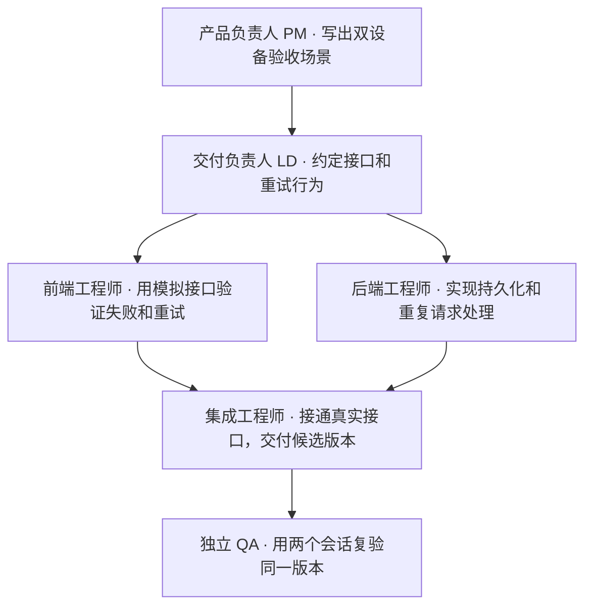

# Pioneers

[English](README.en.md) · [English documentation index](docs/english.md)

Pioneers 让你在现有的 AI 编程助手里带一支研发团队。你给出目标，团队约定怎样算做成，工程师按依赖分头实现，独立 QA 在交付版本上逐项验证。你可以在项目看板上看到哪项决定需要你拍板、谁在等谁，以及这个版本凭什么能交付。

小改动默认只走**开发 → 独立 QA**。例如修复「待办标题全是空格也能提交」，一个工程师修复并自测，另一位 QA 在同一版本上验证空白标题被拒绝、正常标题仍能添加，就可以结项。[查看两步修复示例](examples/small-fix.json)

[在自己的项目里使用](#在智能体平台中使用) · [本地离线演练](#本地-cli-快速开始) · [完整使用手册](docs/usage.md)

## 一个需求怎样在团队里推进

假设用户提出「电脑上新增的待办，手机也要看得见」。**如果手机没收到成功响应，用户又点了一次重试，列表里应该有几条？** 这个答案会同时影响产品体验、接口和测试。[查看多设备同步的完整工作流](examples/todo-sync.json)



**产品和设计交什么？** PM 把「看得见」写成能复现的场景：设备 A 新增，设备 B 能读到；创建失败要能重试，同一次创建最终只出现一条。LD 据此约定哪端的数据为准、接口如何反馈失败、重试如何识别同一次创建。前端可以先用模拟接口工作，后端则实现持久化。仓库里的示例写明了这层依赖，本地 CLI 按依赖串行执行。要让前后端同时领取任务，用干净且已有提交的 Git 项目，为两项任务填写互不重叠的 `write_paths`，再由支持并发的宿主在各自的工作区执行。

**谁能说做完了？** 集成工程师交付候选版本、真实接口联调记录和复现步骤。QA 对照最初的场景重跑。如果重试产生两条待办，QA 可以带着失败证据退回负责的实现任务。修复后，框架重新排队受影响的集成与验收，保留前一轮结果，供两次对照。

这也是 Pioneers 自己的开发方式。给看板增加图片和旁白时，一位工程师对接供应商生成文件，一位负责断线后复用文件，另一位把文件和用量呈现在看板上。合入后，团队从看板实际打开两张纸船图和一段中文旁白，验证用户最终拿得到产物。[查看这轮开发的代码与测试](https://github.com/gunbi/pioneers/compare/c015001...fd46930)

## 你怎样带这支团队

**决定什么时候介入。** 日常小修可以直接开发和验收。涉及权限、共享接口或难以回滚的数据变更，先形成方案，再由你在看板确认。协调会话退出后，独立启动的项目看板仍可审批；重新接入原迭代，团队就能继续领取已放行的任务。[审批与人工介入](docs/usage.md#审批与人工介入) · [执行器故障恢复](docs/usage.md#执行器故障恢复)

**Skill 按角色授权，按任务加载。** 还是双设备同步这个例子，LD 用架构设计 Skill 写接口契约，前端工程师用前端开发 Skill 实现重试，QA 用浏览器测试 Skill 核对两个会话的结果。开发 Chrome 扩展、Electron 或 Tauri 桌面应用时，同一套角色可以换用对应的专业 Skill。完整的角色授权、工具和上游来源都可在仓库中查看。[角色能力清单](capabilities.json) · [Skill 与使用场景](docs/usage.md#角色能力)

### 按任务选用模型供应商

<a id="按任务选用-siliconflow-模型"></a>

配置 SiliconFlow 或 OpenRouter 后，可以直接派工。宿主会按任务能力、复杂度和项目偏好选模型，例如让文本模型起草规格、让视频模型生成素材，再由宿主操作浏览器做独立验收。你可以在项目看板指定或禁用型号、填写「仅免费」等偏好，并查看每次派工的选型依据和实际用量。[模型能力、选择顺序与配置示例](docs/usage.md#按任务选用模型供应商)

## 在智能体平台中使用

在能读取仓库、执行本地命令的编程助手里，打开你的项目，把下面的需求换成你自己的：

> 使用 https://github.com/gunbi/pioneers 的团队来交付。先读取仓库根目录的 agent.md，把当前项目作为工作区，派工前给我项目看板地址。本轮目标是修复待办页面允许提交空白标题的问题，正常标题仍然可以添加。

新项目首次启动时，宿主会询问是否接入模型提供商。回复密钥文件路径即可接入，回复「跳过」即可用宿主继续。初始化项目即默认启用「SiliconFlow 优先、质量优先」，由团队为文本、代码、图片、视频和旁白选用不同型号。也可以自定义「仅免费」等偏好，或使用允许收费模型的默认策略。项目会记住选择，后续可在看板的「模型管理 → 派工策略」修改。

Pioneers 负责计划、派工、交接和验收记录。宿主提供实际执行任务的 Agent、工具和权限。首次真实运行会在目标项目的 `AGENTS.md` 中登记协作规则；下一次在该项目开启会话时，可以接着上一轮的交付记录工作。[宿主协作说明](agent.md)

## 本地 CLI 快速开始

用 Python 3.9 或更高版本即可离线演练，无需模型密钥或额外的 Python 依赖。

```bash
git clone https://github.com/gunbi/pioneers.git
cd pioneers
python3 pioneers.py examples/todo-sync.json
```

在终端打印的 `Run output` 目录里打开 `frontend.md`，找到「前置任务 architecture 的产物」，可以读到 LD 需要约定哪些接口行为。再看 `verification.md`，里面有 QA 要验证的三个场景。这些文件是任务预览。在自己的项目实际开发时，可以使用上面的宿主提示词，或给 CLI 配置执行器。[本地执行器与真实运行](docs/usage.md#给目标让-ld-自主分工)

## 项目看板与迭代记录

同一个项目的历次迭代共用一个看板。开工时可以看分工和依赖，等待时可以审批或调整计划，结项后可以回看验收证据、Git 版本和已登记的发布结果。[启动独立看板和接回原迭代](docs/usage.md#项目看板与迭代记录)

### 云端看板操作

宿主提供私有站点部署或端口预览时，可以在云端查看同一个看板。需要远程审批时，由操作者在私有入口配置控制凭证。[配置云端访问与审批](docs/usage.md#云端看板操作)
